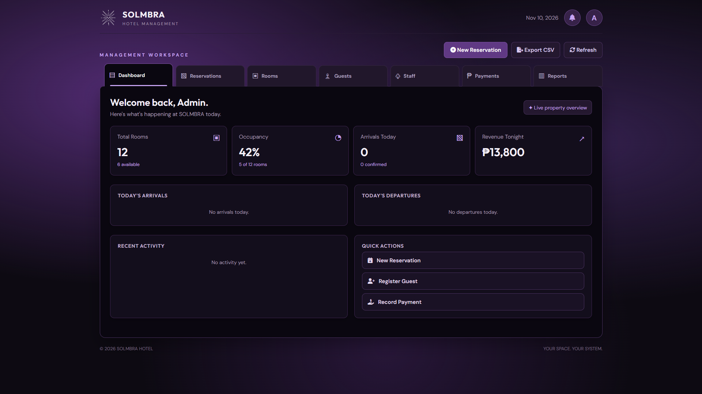
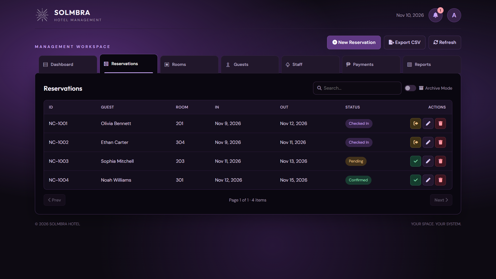
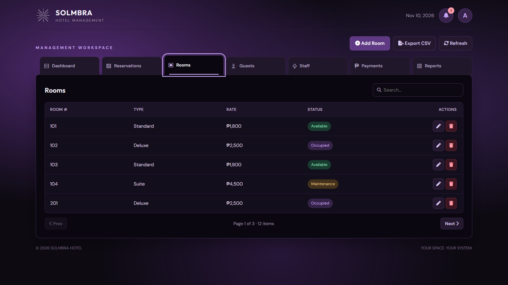
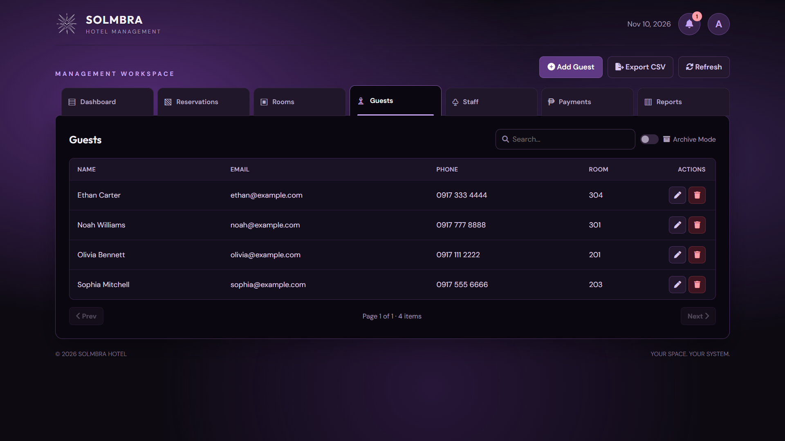
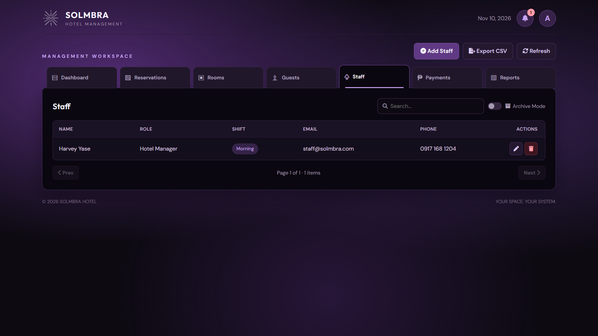
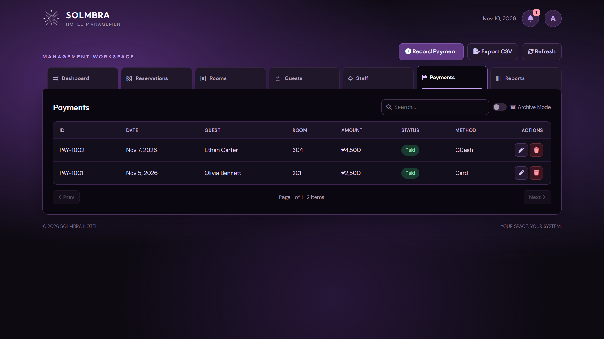
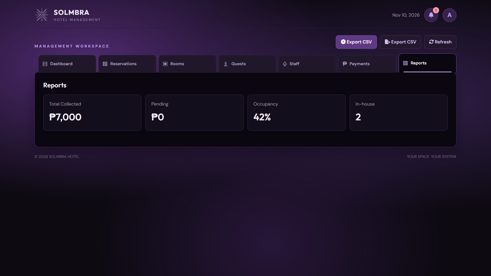
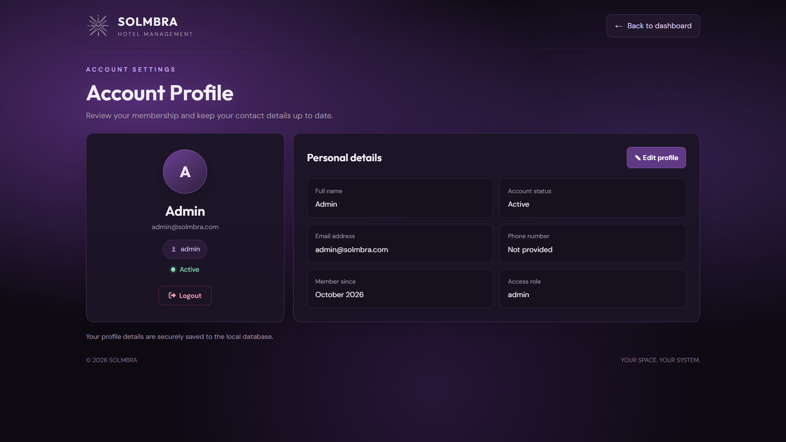

<div align="center">

# 🏨 SOLMBRA

**Hotel Management Made Elegant**

[](https://php.net)
[](https://sqlite.org)
[](#-security-architecture)
[](#)
[](https://opensource.org/licenses/MIT)

*A secure, full-stack local hotel management system built with vanilla PHP, SQLite, and a modern CSS design.*

</div>

---

## 📖 Table of Contents

- [About The Project](#-about-the-project)
- [Core Features](#-core-features)
- [Security Architecture](#-security-architecture)
- [Tech Stack](#-tech-stack)
- [Installation Guide](#%EF%B8%8F-installation-guide)
- [Screenshots](#-screenshots)
- [Group Members](#-group-members)

---

## 🚀 About The Project

**SOLMBRA** is a lightweight, secure, and elegant web application designed for front-desk operations, hotel management, and reservation tracking. It is built without heavy frameworks, relying on pure PHP (backend) and Vanilla JavaScript (frontend) to demonstrate a solid understanding of core web technologies, relational databases, and modern UI/UX design.

> [!NOTE]
> This is a local project designed to run on Apache/XAMPP. It is not currently configured for live cloud hosting.

---

## ✨ Core Features

| Feature | Description |
|---------|-------------|
| 🔐 **Secure Authentication** | Full login system with hashed passwords and brute-force protection. |
| 📊 **Live Dashboard** | Real-time occupancy stats, revenue calculations, and daily arrivals/departures. |
| 📅 **Reservation Engine** | Create, edit, check-in, and check-out guests, with server-side **double-booking prevention**. |
| 🛏️ **Room Sync** | Room statuses (Available, Occupied, Maintenance) automatically sync with active reservations. |
| 💳 **Payment Ledger** | Track payments, methods, and statuses. Financial records are **append-only** (archived, never hard-deleted) for data integrity. |
| 🔔 **Notification System** | In-app inbox for pending reservations and payments, with read/dismiss persistence. |
| 📥 **Export System** | Export any table (Rooms, Guests, Payments) to `.csv` / Excel format. |
| 🛡️ **Role-Based Access Control** | Backend checks ensure only Admins/Managers can delete records. |

---

## 🛡️ Security Architecture

This project was built with security-first principles:

| Threat | Protection |
|--------|------------|
| **SQL Injection** | All database queries use **PDO Prepared Statements**. |
| **XSS** | All dynamic output is escaped using `htmlspecialchars()`. |
| **CSRF** | API state mutations require a valid CSRF token. |
| **Brute-force attacks** | Login attempts are rate-limited (5 tries per 15 minutes). |
| **Database exposure** | The `.htaccess` file blocks direct browser access to `storage/solmbra.sqlite`. |

---

## 🛠 Tech Stack

| Layer | Technology |
|-------|------------|
| **Frontend** | HTML5, CSS3 (Custom, Flexbox/Grid), Vanilla JS (ES6) |
| **Backend** | PHP 8.x (REST-like API architecture) |
| **Database** | SQLite 3 (auto-migrating on first run) |
| **Icons** | FontAwesome 6 |
| **Fonts** | Google Fonts (DM Sans, Outfit) |

---

## ⚙️ Installation Guide

**1. Install XAMPP**

Download and install [XAMPP](https://www.apachefriends.org/) (PHP 8.0+ required).

**2. Clone the repository**

Navigate to your XAMPP `htdocs` folder and clone the project:

```bash
cd C:\xampp\htdocs
git clone https://github.com/harveyyase/solmbra-hotel-management.git solmbra
```

**3. Start Apache**

Open the XAMPP Control Panel and start **Apache**.

**4. Open the app**

Visit [http://localhost/solmbra](http://localhost/solmbra) in your browser. The SQLite database is created and migrated automatically on first run.

---

## 📷 Screenshots

<<<<<<< HEAD
### Dashboard


### Reservations


### Rooms


### Guests


### Staff


### Payments


### Reports


### Account


---

## 👥 Group Members

- Martinez, Minh
- Ruiz, Iesha Katriel
- Kintanar, Francis Matteo C.
- Yase, Harvey Gabriele S.
=======
1.Dashboard

2.Reservation

3.Rooms

4.Guests

5.Staff

6.Payments

7.Reports

8.Account

>>>>>>> 45f50229fe34bcd99e374cc6ec881002a4d7fbca
